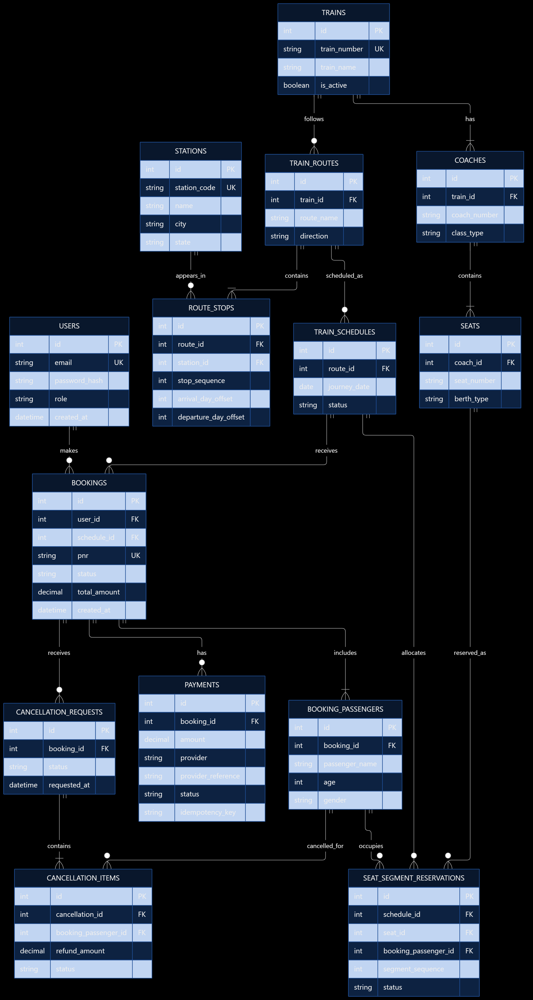

# RailFlow — Database Design & Entity-Relationship Architecture

## 1. Database Design Overview

The **RailFlow** relational database is designed on **PostgreSQL** to support a multi-stop railway reservation and management platform. Unlike a basic CRUD application, a railway reservation system must accurately model physical trains, directional routes, ordered station stops, dated schedules, multi-passenger bookings, payment attempts, partial cancellations, and—most importantly—**segment-level seat availability**.

### Core Architectural Principles
- **Separation of Static Infrastructure vs. Dated Journeys:** Physical trains (`trains`), their directional paths (`train_routes`), and ordered station sequences (`route_stops`) are separated from specific dated runs (`train_schedules`).
- **Segment-Level Seat Allocation:** Seat occupancy is tracked per route segment (`seat_segment_reservations`) rather than locking a seat for an entire train run. This allows multiple passengers to reuse the same physical seat on non-overlapping legs of a journey.
- **Lifecycle & Audit Preservation:** Reservations, payments, and cancellations maintain explicit status transitions (`HELD`, `CONFIRMED`, `CANCELLED`, `EXPIRED`) rather than deleting historical records.
- **Concurrency & Data Integrity:** Uniqueness constraints, partial unique indexes, and foreign key relationships enforce strict consistency at the database level.

---

## 2. List of All 14 Proposed Tables

The database schema is organized into five logical domains comprising **14 tables**:

| # | Domain | Table Name |
| :- | :--- | :--- |
| 1 | User & Identity | `users` |
| 2 | User & Identity | `user_profiles` |
| 3 | Railway Infrastructure | `stations` |
| 4 | Railway Infrastructure | `trains` |
| 5 | Railway Infrastructure | `train_routes` |
| 6 | Railway Infrastructure | `route_stops` |
| 7 | Coaches & Seats | `coaches` |
| 8 | Coaches & Seats | `seats` |
| 9 | Journey & Booking | `train_schedules` |
| 10 | Journey & Booking | `bookings` |
| 11 | Journey & Booking | `booking_passengers` |
| 12 | Journey & Booking | `seat_segment_reservations` |
| 13 | Payment & Cancellation | `payments` |
| 14 | Payment & Cancellation | `cancellation_requests` *(plus `cancellation_items` for line-item refunds)* |

> **Note:** Alongside the 14 core entities shown in the primary ER diagram, `user_profiles` stores optional passenger profile details linked to `users`, and `cancellation_items` tracks per-passenger refund line items under `cancellation_requests` to support partial cancellations.

---

## 3. Explanation of Each Table's Purpose

### A. User & Identity Management
- **`users`**: Stores core authentication credentials (`email`, `password_hash`), user role (`PASSENGER`, `ADMIN`), and account creation timestamps.
- **`user_profiles`**: Stores optional extended passenger details (such as full name, phone number, default ID preferences, and saved traveler details) separated from core authentication data.

### B. Railway Infrastructure
- **`stations`**: Represents physical railway stations (`station_code`, `name`, `city`, `state`).
- **`trains`**: Represents physical or named train services identified by a unique `train_number`, `train_name`, and active status (`is_active`).
- **`train_routes`**: Defines specific directional routes followed by a train (e.g., Up vs. Down routes), linking a `train_id` with `route_name` and `direction`.
- **`route_stops`**: Defines the ordered sequence of stations along a `train_route`, storing `stop_sequence`, `arrival_day_offset`, and `departure_day_offset` to support multi-day overnight journeys.

### C. Coaches & Seats
- **`coaches`**: Represents individual coaches attached to a train (e.g., `S1`, `B1`, `A1`) along with their travel class (`SL`, `3A`, `2A`, `1A`).
- **`seats`**: Represents individual physical seats or berths inside a coach (`seat_number`, `berth_type` such as Lower, Middle, Upper, Side Lower, Side Upper).

### D. Journey & Booking
- **`train_schedules`**: Represents a specific dated journey of a train along a `train_route` on a given `journey_date`, tracking operational status (`SCHEDULED`, `CANCELLED`, `COMPLETED`).
- **`bookings`**: Acts as the reservation header for a user's trip on a specific `train_schedule`, storing the unique `pnr`, overall booking `status`, `total_amount`, and creation timestamp.
- **`booking_passengers`**: Stores individual passenger details (`passenger_name`, `age`, `gender`) belonging to a single `booking`.
- **`seat_segment_reservations`**: The core allocation table that maps a `booking_passenger` and physical `seat` to each individual `segment_sequence` of a `train_schedule`, tracking reservation `status` (`HELD`, `CONFIRMED`, `CANCELLED`, `EXPIRED`).

### E. Payment & Cancellation
- **`payments`**: Records payment attempts associated with a `booking`, including `amount`, `provider`, `provider_reference`, `status`, and an `idempotency_key` to prevent duplicate charges.
- **`cancellation_requests`**: Tracks full or partial cancellation requests submitted against a `booking`, recording request `status` and `requested_at` timestamp.
- **`cancellation_items`**: Links individual `booking_passengers` to a `cancellation_request`, tracking per-passenger `refund_amount` and refund processing `status`.

---

## 4. Primary Keys and Foreign Keys

| Table | Primary Key (PK) | Foreign Keys (FK) | Unique Keys (UK) |
| :--- | :--- | :--- | :--- |
| **`users`** | `id` | — | `email` |
| **`user_profiles`** | `id` | `user_id` → `users(id)` | `user_id` |
| **`stations`** | `id` | — | `station_code` |
| **`trains`** | `id` | — | `train_number` |
| **`train_routes`** | `id` | `train_id` → `trains(id)` | — |
| **`route_stops`** | `id` | `route_id` → `train_routes(id)`<br>`station_id` → `stations(id)` | `(route_id, stop_sequence)` |
| **`coaches`** | `id` | `train_id` → `trains(id)` | `(train_id, coach_number)` |
| **`seats`** | `id` | `coach_id` → `coaches(id)` | `(coach_id, seat_number)` |
| **`train_schedules`** | `id` | `route_id` → `train_routes(id)` | `(route_id, journey_date)` |
| **`bookings`** | `id` | `user_id` → `users(id)`<br>`schedule_id` → `train_schedules(id)` | `pnr` |
| **`booking_passengers`** | `id` | `booking_id` → `bookings(id)` | — |
| **`seat_segment_reservations`** | `id` | `schedule_id` → `train_schedules(id)`<br>`seat_id` → `seats(id)`<br>`booking_passenger_id` → `booking_passengers(id)` | Partial UK on `(schedule_id, seat_id, segment_sequence)` where active |
| **`payments`** | `id` | `booking_id` → `bookings(id)` | `provider_reference`, `idempotency_key` |
| **`cancellation_requests`** | `id` | `booking_id` → `bookings(id)` | — |
| **`cancellation_items`** | `id` | `cancellation_id` → `cancellation_requests(id)`<br>`booking_passenger_id` → `booking_passengers(id)` | — |

---

## 5. Relationship Cardinalities

| Relationship | Cardinality | Explanation |
| :--- | :--- | :--- |
| `USERS` → `USER_PROFILES` | **One-to-One (`1:0..1`)** | A user may have one optional extended profile. |
| `USERS` → `BOOKINGS` | **One-to-Many (`1:N`)** | One user can make zero or many bookings; each booking belongs to one user. |
| `TRAINS` → `TRAIN_ROUTES` | **One-to-Many (`1:N`)** | A train can operate on multiple directional routes. |
| `TRAIN_ROUTES` → `ROUTE_STOPS` | **One-to-Many (`1:N`)** | Each route consists of multiple ordered station stops. |
| `STATIONS` → `ROUTE_STOPS` | **One-to-Many (`1:N`)** | A single station can appear across many different train routes. |
| `TRAINS` → `COACHES` | **One-to-Many (`1:N`)** | A train is composed of multiple coaches (`SL`, `3A`, `2A`, etc.). |
| `COACHES` → `SEATS` | **One-to-Many (`1:N`)** | Each coach contains multiple physical seats or berths. |
| `TRAIN_ROUTES` → `TRAIN_SCHEDULES` | **One-to-Many (`1:N`)** | A route can have many scheduled runs across different calendar dates. |
| `TRAIN_SCHEDULES` → `BOOKINGS` | **One-to-Many (`1:N`)** | A dated train schedule receives many passenger bookings. |
| `BOOKINGS` → `BOOKING_PASSENGERS` | **One-to-Many (`1:N`)** | A single booking (PNR) can include one or more passengers. |
| `TRAIN_SCHEDULES` → `SEAT_SEGMENT_RESERVATIONS` | **One-to-Many (`1:N`)** | A schedule allocates seat segments across its active bookings. |
| `SEATS` → `SEAT_SEGMENT_RESERVATIONS` | **One-to-Many (`1:N`)** | A physical seat can be reserved across multiple schedules and non-overlapping segments. |
| `BOOKING_PASSENGERS` → `SEAT_SEGMENT_RESERVATIONS` | **One-to-Many (`1:N`)** | One passenger occupies one reservation row per route segment traveled. |
| `BOOKINGS` → `PAYMENTS` | **One-to-Many (`1:N`)** | A booking can have multiple payment attempts (e.g., after a failed retry). |
| `BOOKINGS` → `CANCELLATION_REQUESTS` | **One-to-Many (`1:N`)** | A booking can have one or more full or partial cancellation requests. |
| `CANCELLATION_REQUESTS` → `CANCELLATION_ITEMS` | **One-to-Many (`1:N`)** | Each cancellation request contains line items for the specific passengers cancelled. |
| `BOOKING_PASSENGERS` → `CANCELLATION_ITEMS` | **One-to-One (`1:0..1`)** | A passenger in a booking can be cancelled at most once. |

---

## 6. Complete Mermaid ER Diagram



```mermaid
erDiagram
    USERS ||--o{ BOOKINGS : makes
    USERS ||--o| USER_PROFILES : has
    TRAINS ||--o{ TRAIN_ROUTES : follows
    TRAIN_ROUTES ||--|{ ROUTE_STOPS : contains
    STATIONS ||--o{ ROUTE_STOPS : appears_in
    TRAINS ||--o{ COACHES : has
    COACHES ||--|{ SEATS : contains
    TRAIN_ROUTES ||--o{ TRAIN_SCHEDULES : scheduled_as
    TRAIN_SCHEDULES ||--o{ BOOKINGS : receives
    BOOKINGS ||--|{ BOOKING_PASSENGERS : includes
    TRAIN_SCHEDULES ||--o{ SEAT_SEGMENT_RESERVATIONS : allocates
    SEATS ||--o{ SEAT_SEGMENT_RESERVATIONS : reserved_as
    BOOKING_PASSENGERS ||--|{ SEAT_SEGMENT_RESERVATIONS : occupies
    BOOKINGS ||--o{ PAYMENTS : has
    BOOKINGS ||--o{ CANCELLATION_REQUESTS : receives
    CANCELLATION_REQUESTS ||--|{ CANCELLATION_ITEMS : contains
    BOOKING_PASSENGERS ||--o| CANCELLATION_ITEMS : cancelled_for

    USERS {
        int id PK
        string email UK
        string password_hash
        string role
        datetime created_at
    }

    USER_PROFILES {
        int id PK
        int user_id FK
        string full_name
        string phone
    }

    STATIONS {
        int id PK
        string station_code UK
        string name
        string city
        string state
    }

    TRAINS {
        int id PK
        string train_number UK
        string train_name
        boolean is_active
    }

    TRAIN_ROUTES {
        int id PK
        int train_id FK
        string route_name
        string direction
    }

    ROUTE_STOPS {
        int id PK
        int route_id FK
        int station_id FK
        int stop_sequence
        int arrival_day_offset
        int departure_day_offset
    }

    COACHES {
        int id PK
        int train_id FK
        string coach_number
        string class_type
    }

    SEATS {
        int id PK
        int coach_id FK
        string seat_number
        string berth_type
    }

    TRAIN_SCHEDULES {
        int id PK
        int route_id FK
        date journey_date
        string status
    }

    BOOKINGS {
        int id PK
        int user_id FK
        int schedule_id FK
        string pnr UK
        string status
        decimal total_amount
        datetime created_at
    }

    BOOKING_PASSENGERS {
        int id PK
        int booking_id FK
        string passenger_name
        int age
        string gender
    }

    SEAT_SEGMENT_RESERVATIONS {
        int id PK
        int schedule_id FK
        int seat_id FK
        int booking_passenger_id FK
        int segment_sequence
        string status
    }

    PAYMENTS {
        int id PK
        int booking_id FK
        decimal amount
        string provider
        string provider_reference
        string status
        string idempotency_key
    }

    CANCELLATION_REQUESTS {
        int id PK
        int booking_id FK
        string status
        datetime requested_at
    }

    CANCELLATION_ITEMS {
        int id PK
        int cancellation_id FK
        int booking_passenger_id FK
        decimal refund_amount
        string status
    }

## 7. Seat-Segment Reservation Example

Consider **Train 12345** running on **Schedule 101** along the following 4-station route:

1. **New Delhi** (`stop_sequence = 1`)
2. **Agra Cantt** (`stop_sequence = 2`)
3. **Bhopal Junction** (`stop_sequence = 3`)
4. **Mumbai Central** (`stop_sequence = 4`)

This route is broken down into **3 atomic journey segments**:

| `segment_sequence` | From Station | To Station |
| :---: | :--- | :--- |
| **1** | New Delhi (`stop 1`) | Agra Cantt (`stop 2`) |
| **2** | Agra Cantt (`stop 2`) | Bhopal Junction (`stop 3`) |
| **3** | Bhopal Junction (`stop 3`) | Mumbai Central (`stop 4`) |

### Scenario Walkthrough on Physical Seat `S1`

1. **Rahul books New Delhi → Bhopal Junction (`stop 1` to `stop 3`):**
   - Covers segments **1** and **2**.
   - The database inserts two active rows in `seat_segment_reservations`:

   | `schedule_id` | `seat_id` | `segment_sequence` | Passenger | `status` |
   | :---: | :---: | :---: | :--- | :--- |
   | `101` | `S1` | `1` | Rahul | `CONFIRMED` |
   | `101` | `S1` | `2` | Rahul | `CONFIRMED` |

2. **Aman books Bhopal Junction → Mumbai Central (`stop 3` to `stop 4`):**
   - Covers segment **3**.
   - Segment **3** is free for seat `S1`, so the booking is **ALLOWED**:

   | `schedule_id` | `seat_id` | `segment_sequence` | Passenger | `status` |
   | :---: | :---: | :---: | :--- | :--- |
   | `101` | `S1` | `3` | Aman | `CONFIRMED` |

3. **Third Passenger attempts to book New Delhi → Agra Cantt (`stop 1` to `stop 2`) on Seat `S1`:**
   - Requires segment **1**.
   - Segment **1** already has an active reservation (`CONFIRMED` for Rahul), so the database constraint rejects the duplicate allocation and the booking is **REJECTED** for seat `S1`.

---

## 8. Important Database Constraints

To ensure strict data integrity and prevent race-condition double bookings, the PostgreSQL schema enforces the following constraints:

| Table | Constraint Rule | Purpose |
| :--- | :--- | :--- |
| **`users`** | `UNIQUE (email)` | Prevents duplicate user accounts with the same email. |
| **`stations`** | `UNIQUE (station_code)` | Ensures each station code (e.g., `NDLS`, `BPL`) is unique. |
| **`trains`** | `UNIQUE (train_number)` | Ensures each train number (e.g., `12345`) is unique. |
| **`route_stops`** | `UNIQUE (route_id, stop_sequence)` | Prevents two stations from occupying the exact same stop order on a route. |
| **`route_stops`** | `UNIQUE (route_id, station_id)` | Prevents duplicate station entries on a single linear route. |
| **`coaches`** | `UNIQUE (train_id, coach_number)` | Ensures coach labels (`S1`, `B1`) are unique per train. |
| **`seats`** | `UNIQUE (coach_id, seat_number)` | Ensures seat/berth numbers are unique within each coach. |
| **`train_schedules`** | `UNIQUE (route_id, journey_date)` | Prevents scheduling the same train route twice on the same date. |
| **`bookings`** | `UNIQUE (pnr)` | Guarantees globally unique PNR numbers for ticket lookup. |
| **`seat_segment_reservations`** | **Partial Unique Index** on `(schedule_id, seat_id, segment_sequence) WHERE status IN ('HELD', 'CONFIRMED')` | Guarantees a seat cannot be double-booked on the same schedule segment while allowing `CANCELLED` or `EXPIRED` rows to release the seat for future passengers. |
| **`payments`** | `UNIQUE (provider_reference)` & `UNIQUE (idempotency_key)` | Prevents duplicate payment processing on network retries. |
| **Application / Domain Rule** | `boarding_stop_sequence < destination_stop_sequence` | Prevents invalid reverse-direction bookings along a directional route. |
| **Application / Domain Rule** | Train-Route-Seat Compatibility | Ensures the `seat_id` reserved belongs to a `coach` attached to the exact `train` running on the booked `train_schedule`. |

